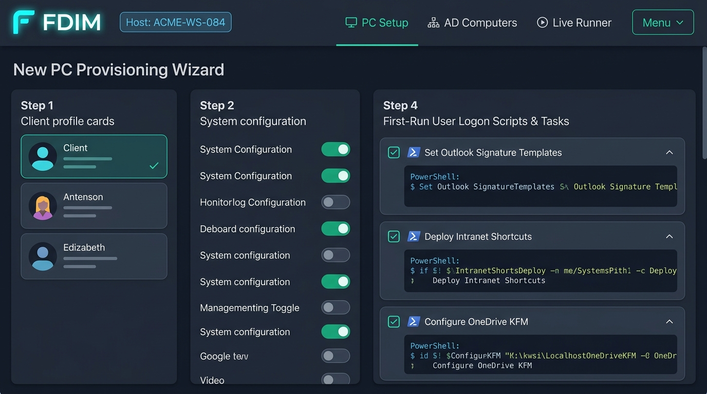
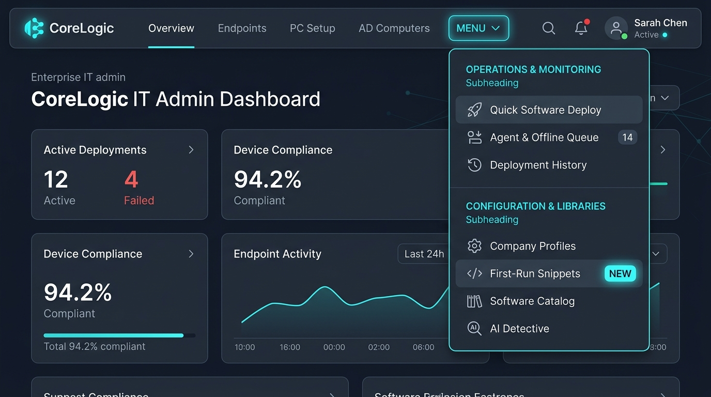
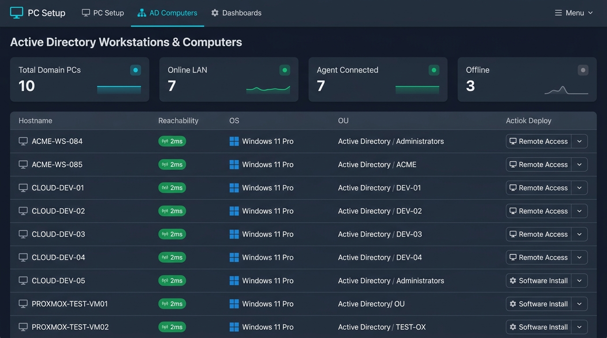
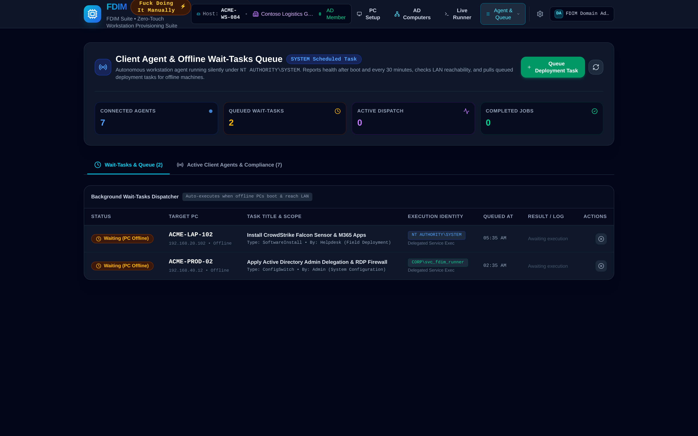
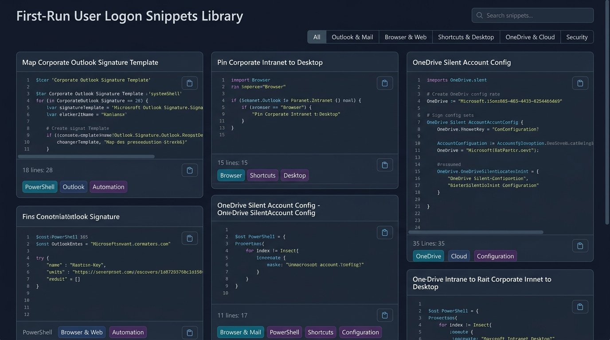
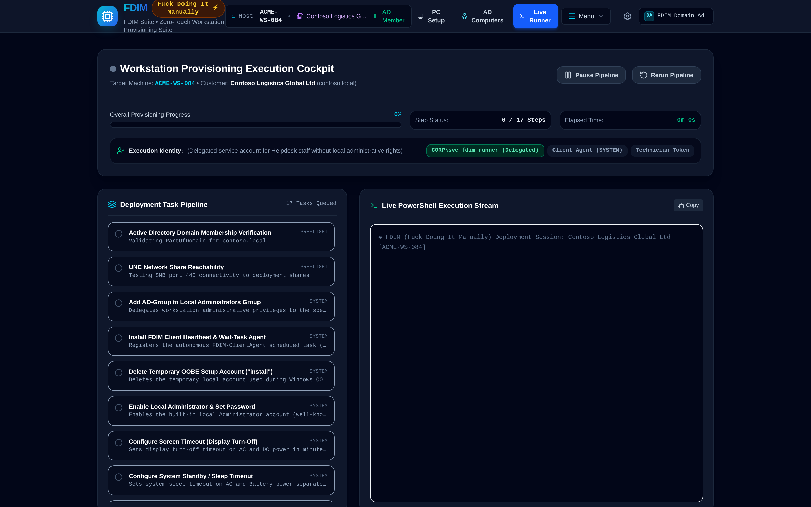

# FDIM — Fuck Doing It Manually 🖥️⚡

> **Enterprise Workstation Provisioning & Silent Software Deployment Platform for Active Directory Environments**

**FDIM** (**Fuck Doing It Manually**) is an automated deployment and administrative configuration platform built for IT Systems Administrators, MSPs (Managed Service Providers), and Helpdesk teams. It streamlines the onboarding of Windows client workstations that are already joined to a local or hybrid **Active Directory** domain with pre-configured hostnames.

With FDIM, technicians can select or customize client profiles, enforce critical enterprise system configurations (RDP, delegated AD admin groups, power schemes), select silent software packages from UNC network shares with tailored installer switches (including config file imports like TeamViewer Host `.tvopt`), and either generate production-grade, self-logging PowerShell deployment scripts or execute them via an interactive live runner.

---



---

## 🚀 Key Features

### 🧭 Streamlined Navigation & Centralized Operations Menu



- **Zero-Clutter Header Architecture**: Completely overhauled navigation eliminating header overload with a clean, focused primary bar:
  - **PC Setup**: Interactive workstation provisioning wizard with auto-save draft state.
  - **AD Computers**: Live Active Directory computer inventory with ICMP ping reachability and bulk rollouts.
  - **Live Runner**: Real-time PowerShell execution terminal with live logging.
- **Unified Two-Section Dropdown Menu (`Menu ▾`)**:
  - **Operations & Monitoring**: Fast access to *Quick Software Deploy*, *Autonomous Client Agent & Offline Wait Queue* (with live task count badge), and *Deployment History & Transcripts*.
  - **Configuration & Libraries**: Dedicated views for *Customer & Multi-Tenant Profiles*, *First-Run Snippets Library* (marked with a **NEW** indicator), *Software Catalog* (UNC shares & Winget), and *AI Installer Detective* (powered by Google Gemini).
- **Keyboard & Touch Optimized**: Instant dropdown toggle with outside-click dismissal, active route highlight indicators, and badge counts.

### 💾 Workstation Wizard Auto-Save & Draft Persistence
- **Continuous Local Storage Persistence**: The New PC Provisioning Wizard automatically saves your in-progress machine configuration to browser `localStorage` with a smooth 300ms debounce.
- **Full Configuration Retention**: Preserves target hostname (`machineName`), selected customer profile, software package selections, per-package custom switches and `.tvopt` configuration files, dynamic system switches, parameter values (such as AD admin groups and timeout values), staged network drives, staged printers, and first-logon provisioning settings.
- **Zero-Loss Workflow**: Technicians can freely navigate between tabs (Customer Profiles, Software Library, Deployment History, System Switches, App Settings) or refresh/close the browser without losing their tailored deployment parameters.
- **Visual Status Badges**:
  - Live draft status indicator in the top header card (*Draft auto-saved (Just now / 2m ago)* or *Saving draft...*).
  - Restoration alert banner upon returning with a saved draft.
  - One-click **Reset to Profile Defaults** button to instantly revert to clean customer profile defaults at any time.
  - Persistence indicator badge in the zero-touch deployment launcher bar.

### 🖥️ Active Directory Computers Directory & Multi-PC Bulk Rollouts



- **Live AD Domain Computer Inventory**: Complete directory of all domain-joined client workstations, Laptops, and departmental PCs with real-time status tracking.
- **LDAP Tree Sync & Auto-Discovery**: One-click LDAP synchronization with corporate Domain Controllers (`(&(objectCategory=computer)(objectClass=user))`) to discover new endpoints and track OU memberships.
- **Granular Filter & Search Bar**: Instant search across hostnames, IP addresses, active users, descriptions, and Organizational Units (OUs like `OU=Workstations`, `OU=Finance`, `OU=Laptops`).
- **ICMP / WinRM LAN Ping Reachability**: Verify online connectivity and roundtrip latency across all endpoints before launching tasks.
- **Multi-PC Bulk Deployment**: Check multiple workstations to deploy software packages across entire departments or branches with a single click.
- **Hostnames & CSV Import**: Bulk paste lists of computer names or import CSV exports directly into FDIM.

### 🤖 Autonomous Client Agent & Offline Wait-Tasks Engine



- **Invisible Windows Scheduled Task**: Installs the `FDIM-ClientAgent` scheduled task on Windows 10/11 endpoints running under `NT AUTHORITY\SYSTEM`—completely silent and invisible to interactive users.
- **Startup Boot Trigger & Recurring Heartbeat**:
  - Automatically triggers at system startup with a configurable 3-5 minute delay (ensuring network adapters and DHCP lease are fully acquired).
  - Recurs indefinitely on a 15, 30, or 60-minute recurring schedule.
  - Checks ICMP/LAN reachability before initiating network calls.
  - Sends a secure heartbeat with hardware status, OS build, active logged-in user, uptime, and installed package inventory.
- **Wait-Tasks for Offline Workstations**:
  - When triggering deployments to machines that are currently powered off or disconnected, FDIM queues them as **Wait-Tasks**.
  - A persistent background dispatcher continually monitors client check-ins; the exact moment an offline machine boots and checks in, the agent pulls and executes the silent installation unattended as SYSTEM, reporting return exit codes and transcripts back to the central console!
- **1-Liner PowerShell GPO Deployment**: Generates ready-to-run installation scripts (`Install-FDIMAgent.ps1`) deployable via GPO Startup Script, Intune, or one-liner:
  ```powershell
  irm http://<fdim-server>:3000/api/agent/script/installer | iex
  ```

### 🧪 Package Sandbox Testing with Proxmox VE & Automatic Rollback
- **Isolated VM Testing**: Safely test unknown, modified, or updated software packages in an isolated Windows VM template on Proxmox VE, Hyper-V, or container sandbox before pushing to production.
- **Unattended Execution Verification**: Runs silent arguments, monitors process execution time, and validates official exit codes (`0`, `3010`).
- **Compliance Detection Verification**: Tests registry and file path detection rules in real-time.
- **Automatic Snapshot Rollback (Restore Clean Baseline)**: Reverts the test VM to its pristine baseline snapshot (`clean-baseline`) via the Proxmox VE API immediately after testing, ensuring a clean state for subsequent tests.

### 🛡️ Delegated Helpdesk Execution (Delegated Service Account for Runner)
- **Non-Admin Helpdesk Deployment**: Allows Tier-1 Helpdesk technicians and Junior IT staff without Domain Admin privileges or local administrative accounts to trigger and dispatch software installations.
- **Elevated Execution Identities**:
  - **Client Agent (SYSTEM)**: Autonomous execution via local SYSTEM token.
  - **Delegated Service Account**: Configurable dedicated service account (e.g., `CORP\svc_fdim_runner`).
  - **Technician Interactive Token**: Direct execution with elevated technician credentials.

### 🏢 Customer & Multi-Tenant Profiles
- **Client Organization Management**: Maintain isolated configuration profiles for different companies, branches, or customer domains (e.g., Acme Industrial, MediCare Solutions, CloudScale Tech).
- **Domain & AD Group Automation**: Predefine customer domain names, target delegated Active Directory administrative groups, and primary UNC software repository paths.
- **Default Software Blueprints**: Assign company-specific default software packages that are automatically pre-selected when launching the deployment wizard.
- **Profile Deletion with Safety Validation**: Easily delete obsolete customer profiles directly from profile cards (trash icon) or inside the editor modal. A confirmation modal displays company details, domain, and mapped resources before permanent removal, with automatic fallback to prevent orphaned states.

### ⚡ Quick Software Deployment Mode
- **Rapid Software-Only Rollouts**: Dedicated workflow for existing, already-configured workstations that only require new software installations or silent application patching without running operating system provisioning tasks.
- **Batch Selection**: Select target machines, domain, and one or more UNC / Winget packages.
- **Instant PowerShell Script Generation & Execution**: Generate hardened unattended install scripts or trigger deployment instantly.

### 🎨 Corporate Brand Colors & Portal Appearance
- **Custom Corporate Color Schemes**: Configure custom primary and secondary brand accent colors to match your organization's or MSP's corporate identity.
- **1-Click Presets & Custom Pickers**: Choose from 8 pre-tuned palettes (**Cyber Cyan**, **Enterprise Blue**, **MSP Emerald**, **Royal Indigo**, **Executive Purple**, **Amber Glow**, **Crimson Ops**, **Titanium Slate**) or specify custom HEX codes and HTML color pickers.
- **Dynamic CSS Variable Theming**: Injects `--brand-primary` and `--brand-secondary` custom properties live across action buttons, active tab indicators, glowing badges, and banner gradients.
- **Corporate Organization Title**: Customize the portal brand name displayed in headers and compliance handover reports (e.g., `FDIM Enterprise Suite`, `Acme Managed Workplace`).
- **Live Real-Time Theme Preview**: Preview your color palette, buttons, badges, and certificates instantly inside the Settings modal before saving to persistent SQLite storage.

### 🛡️ Per-User Acronym & Safe-For-Work (SFW) Profanity Switch
- **Granular Per-Technician Preference**: Technicians and system administrators can individually choose whether they want to see the original IT humor acronym or a clean corporate safe-for-work phrasing.
- **Two Distinct Operating Modes**:
  - **⚡ Uncensored Mode**: Displays **"Fuck Doing It Manually"** across application banners, technician cards, and script transcripts.
  - **🛡️ Corporate Safe-For-Work (SFW) Mode**: Displays **"Forget Doing It Manually"** across all headers, certificate handovers, and generated PowerShell scripts—safe for client presentations, management reviews, and external compliance audits.
- **Instant Header Quick-Toggle**: Click the acronym badge in the top navigation bar to toggle phrasing on the fly with live visual feedback.
- **Full Scope Coverage**: Phrasing preferences automatically synchronize across the top navigation bar, New PC Provisioning Wizard banner, Script Generator modal, Live Deployment Runner session logs, Audit Handover Compliance certificates, and generated unattended PowerShell master scripts.
- **Persistent Retention**: Saved per technician in both browser `localStorage` and backend SQLite database (`users` table and `/api/auth/preferences`).

### 🔐 Enterprise Authentication & Role Management
- **Multi-Mode Authentication Engine**:
  - **Local Accounts**: Built-in technician credentials with role-based access control (RBAC).
  - **Active Directory / LDAP**: Real-time integration with corporate domain controllers via secure LDAPS (`ldaps://...:636`), customizable Base DN, bind service accounts, user search filters (`sAMAccountName={username}`), and AD admin group mapping.
  - **Keycloak / OIDC**: Enterprise Single Sign-On (SSO) integration supporting OpenID Connect realms, client credentials, and token validation.
- **Global Settings Manager**: Dedicated settings modal to configure default corporate domain roots and authentication provider settings.

### 🤖 AI Installer Detective (Powered by Google Gemini)
- **Automated Silent Switch Discovery**: Analyze unknown, third-party, or legacy setup executables to identify silent installation flags (`/S`, `/silent`, `/qn`, `/VERYSILENT`).
- **Hanging & Dialog Detection**: Detect potential interactive prompts, reboot requests, or blocking dialogs that could stall zero-touch deployments, providing recommended timeout and containment parameters.

### 🗄️ Native SQLite Persistent Storage
- **Built-in Node.js SQLite (`node:sqlite`)**: Lightweight, zero-native-compilation database engine providing reliable persistent storage across server restarts for customer profiles, software packages, system switches, app settings, and deployment logs.

### 🛡️ Enterprise Active Directory & System Configuration Switches
- **Tailored for Existing Domain Members**: Optimized for PCs that already have hostnames (`$env:COMPUTERNAME`) and domain membership—no redundant serial numbers or employee assignee overhead.
- **Local Administrator Account Provisioning**:
  - Automatically identifies the built-in local Administrator account across any Windows language pack (using the well-known SID `S-1-5-21-*-500`).
  - Enables the account (`Enable-LocalUser`) to guarantee emergency local recovery access.
  - Configures a secure local administrator password (custom or one-click 16-character cryptographic generator compliant with Windows complexity requirements).
  - Enforces `PasswordNeverExpires=$true` for long-term recovery stability.
- **Temporary Windows OOBE Setup Account Cleanup ("install")**:
  - Automatically locates and deletes the temporary local account created by technicians during initial Windows Out-Of-Box Experience (OOBE) setup screens (default username: `"install"`, with support for custom names like `setup`, `oobe`, `temp`).
  - Cleans up and unregisters the user profile from `Win32_UserProfile` and purges the profile directory on disk (`C:\Users\install`) so no unmanaged or insecure temporary accounts remain on deployed endpoints.
  - Safe execution: If the provisioning runner is currently executing inside the active session of the OOBE account, it automatically stages a safe post-reboot/logoff removal via `HKLM:\SOFTWARE\Microsoft\Windows\CurrentVersion\RunOnce`, preventing session termination.
- **Enable Remote Desktop (RDP)**: Configures Terminal Server registry keys, enforces Network Level Authentication (NLA), and unblocks Remote Desktop in Windows Defender Firewall.
- **Delegate AD Groups to Local Administrators**: Automatically adds specified Active Directory security groups (e.g., `DOMAIN\IT-DesktopAdmins`) into the local `Administrators` security group with domain resolution safety checks.
- **Power Management (powercfg)**: Standardizes AC monitor sleep and standby/sleep timeouts via `powercfg.exe` to prevent workstations from sleeping during maintenance windows or user shifts. Optional switch toggle allows technicians to disable power scheme enforcement when desired.
- **Dynamic Switch Manager**: Technicians can create, modify, or retire custom system configuration switches with dynamic input parameters and custom PowerShell script snippets.

### 📦 UNC Software Catalog & Winget Package Manager Integration
- **Hybrid Distribution Strategy**: Deploy software packages silently either from local SMB/UNC network shares (e.g., `\\fs01.acme.corp\software$\...`) OR directly from official Microsoft Windows Package Manager (**Winget**) repositories.
- **Default Winget Catalog Items**: Preloaded support for essential workstation software that doesn't need to live on the local UNC share:
  - **7-Zip** (`7zip.7zip`)
  - **VLC Media Player** (`VideoLAN.VLC`)
  - **Microsoft Outlook Classic (`pkg-outlook-classic`)**: Configured with the **Office Deployment Tool (ODT / Click-to-Run)** unattended installer (`/configure configuration-outlook.xml`) or custom UNC/HTTP share. Solves the limitation where Winget only distributes the new web-based Outlook and does not offer classic desktop Outlook.
  - **Google Chrome** (`Google.Chrome`)
  - **Notepad++** (`Notepad++.Notepad++`)
  - **Adobe Acrobat Reader DC** (`Adobe.Acrobat.Reader.64-bit`)
- **Installer Presets & Silent Switches**: Built-in support and parameter presets for:
  - **Winget**: `winget install --id "<ID>" --exact --silent --accept-package-agreements --accept-source-agreements --disable-interactivity`
  - **MSI / Windows Installer**: `/qn /norestart ALLUSERS=1` with custom public properties (`ASSIGNMENTOPTIONS`, `APITOKEN`, etc.).
  - **Inno Setup**: `/VERYSILENT /SUPPRESSMSGBOXES /NORESTART /SP-`
  - **NSIS**: `/S`
  - **WiX Toolset**: `/quiet /norestart`
  - **TeamViewer Host**: Full support for config file imports (`.tvopt`), API tokens, and assignment options.
- **Manual Package Creation (No AI Required)**: Quickly register internal or bespoke enterprise packages (UNC or Winget) with custom detection rules (registry keys or file paths), silent arguments, and installation timeout safeguards.
- **AI-Assisted Switch Discovery**: Optional switch and silent argument discovery for rare or legacy installers via the Gemini API.

### 📜 Automated PowerShell Script Synthesis
- Generates hardened, stand-alone `.ps1` deployment scripts that:
  - Require elevation (`#Requires -RunAsAdministrator`).
  - Verify Active Directory domain reachability prior to execution.
  - Test UNC path availability before downloading or running installers.
  - Maintain an execution transcript log in `C:\ProgramData\FDIM\Logs\`.
  - Report exact return exit codes with graceful rollback warnings.

### 🖧 User First-Logon Staging & Central Snippets Library



- **Solves Non-Logged-In User Limitation**: Workstation provisioning runs as Administrator or SYSTEM before the employee ever logs in. Network drive mappings (`HKCU:\Network`), per-user network printers, and user profile customizations require the user's interactive Kerberos security token.
- **Dedicated Central First-Run Snippets Library (`FirstRunSnippetsManager`)**:
  - Central manager tab to organize, write, and maintain reusable PowerShell user-logon script blocks.
  - Granular categories: `Outlook & Mail`, `Browser & Web`, `Shortcuts & Desktop`, `OneDrive & Cloud`, `Security & Policies`, `Custom`.
  - Rich metadata support: snippet name, description, author, categorized tags, global template flag, and syntax-highlighted PowerShell code viewer.
  - Pre-seeded enterprise templates:
    - **Corporate Outlook Signature Template Mapping**: Copies signature HTML/RTF files to `$env:APPDATA\Microsoft\Signatures` and sets default Outlook signatures.
    - **Pin Corporate Intranet to Desktop & Start**: Creates custom desktop and start menu `.url` shortcuts for intranet portals and IT helpdesks.
    - **OneDrive Silent Account Config & KFM**: Silently signs into OneDrive with Azure AD credentials and enables Known Folder Move (Desktop, Documents, Pictures backup).
    - **Microsoft Edge Corporate Start Page & Search**: Configures default homepage, intranet tabs, and search provider in the user registry.
    - **Corporate Branded Desktop Wallpaper**: Deploys company wallpaper from UNC share to local cache and updates shell parameters via `SystemParametersInfo`.
    - **Disable Windows Diagnostic Data & Consumer Telemetry**: Removes user-level diagnostic telemetry prompts and consumer Bing suggestions.
    - **Post-Provisioning Cleanup**: Removes temporary setup scripts, clears staging logs, and self-cleans post-execution.
- **Direct PC-Setup Wizard Integration (Step 4)**:
  - Technicians can pick, enable/disable, preview code, expand/collapse, and add custom ad-hoc user-logon snippets directly on the machine being staged in the New PC Setup tab—not just inside corporate customer profiles!
- **Customer Profile Defaults**:
  - Link default snippet IDs into company customer profiles. Selecting a customer in Step 1 automatically activates their standard corporate first-run scripts.
- **Enterprise Dual-Engine Execution**:
  1. **Per-Machine Network Printers**: Configured machine-wide during provisioning using `rundll32 printui.dll,PrintUIEntry /ga /n"\\printserver\printer"`, making them immediately available to every present and future user on the PC.
  2. **Active Setup First-Logon Staging**: FDIM generates a self-contained payload at `C:\ProgramData\FDIM\UserLogonSetup.ps1` and registers it in `HKLM:\SOFTWARE\Microsoft\Active Setup\Installed Components\FDIM_UserProvisioning` (with a secondary Scheduled Task trigger at logon). When any user signs in for the first time, the Windows Shell silently executes the script in their user context, mapping persistent drives (`net use S: "\\server\share" /persistent:yes` with dynamic `%USERNAME%` resolution), assigning printers, and executing all enabled first-run snippets!

### ⏱️ Interactive Live Runner & Audit Certificates



- **Step-by-Step Execution Console**: Real-time simulated or live execution terminal with timer tracking, status chips, and step-level rerun capabilities.
- **Compliance Audit Certificates**: Generates downloadable, cryptographically identifiable completion certificates documenting machine hostname, domain, customer profile, applied system switches, and installed package inventory.
- **Historical Deployment Log**: Filterable record of historical deployments with fast export and review capabilities.

---

## 📸 Screenshots & Visual Tour

| **Workstation Deployment Wizard** | **Streamlined Operations & Config Menu** |
|:---:|:---:|
|  |  |
| *Streamlined provisioning: Customer profile, System configuration, and Step 4 First-Run Snippets* | *Clutter-free navigation: Operations & Monitoring + Configuration & Libraries dropdown* |

| **First-Run User Logon Snippets Library** | **Active Directory Computers Directory** |
|:---:|:---:|
|  |  |
| *Central library of reusable PowerShell user logon scripts with categorizations & tags* | *LDAP domain inventory with real-time ping reachability & multi-PC bulk rollouts* |

| **Live Runner PowerShell Terminal** | **Autonomous Client Agent & Wait-Tasks Queue** |
|:---:|:---:|
|  |  |
| *Real-time PowerShell execution stream with pipeline steps & live logging* | *Offline machine wait-tasks dispatcher, recurring heartbeat graph & scheduled tasks* |

---

### 🏗️ Architecture & Tech Stack

```
┌─────────────────────────────────────────────────────────────────────────────┐
│                               Client Browser                                │
│        React 19 • Vite • Tailwind CSS • Lucide Icons • Motion               │
│                                                                             │
│  ┌───────────────────────────────────────────────────────────────────────┐  │
│  │ Primary Navigation Bar: [PC Setup] [AD Computers] [Live Runner] [Menu]│  │
│  └───────────────────────────────────────────────────────────────────────┘  │
│                                      │                                      │
│         ┌────────────────────────────┴────────────────────────────┐         │
│         ▼                                                         ▼         │
│  ┌───────────────────────────────┐      ┌────────────────────────────────┐  │
│  │ Operations & Monitoring       │      │ Configuration & Libraries      │  │
│  │ • Quick Software Deploy       │      │ • Customer Profiles & Tenants  │  │
│  │ • Client Agent & Wait Queue   │      │ • First-Run Snippets [NEW]     │  │
│  │ • Deployment History & Logs   │      │ • Software Catalog (UNC/Winget)│  │
│  │ • Live Execution Terminal     │      │ • AI Detective (Gemini API)    │  │
│  └───────────────────────────────┘      └────────────────────────────────┘  │
│                                      │                                      │
│                  Browser LocalStorage Draft Cache (300ms)                   │
└──────────────────────────────────────┬──────────────────────────────────────┘
                                       │ HTTP / JSON REST APIs
┌──────────────────────────────────────▼──────────────────────────────────────┐
│                              Node.js / Express                              │
│                              (server.ts / tsx)                              │
│                                                                             │
│  • Customer Profiles Store          • First-Run Logon Snippets Library      │
│  • Dynamic System Switches Engine   • Software Catalog & ODT Packages       │
│  • Autonomous Client Agent Engine   • PowerShell Script Synthesizer         │
│  • Deployment History & Audit Logs  • Google Gemini AI Installer Analysis   │
│  • AD/LDAP & Keycloak Auth Proxy    • Native SQLite Engine (node:sqlite)    │
└─────────────────────────────────────────────────────────────────────────────┘
```

- **Frontend**: [React 19](https://react.dev/), [TypeScript](https://www.typescriptlang.org/), [Tailwind CSS v4](https://tailwindcss.com/), [Lucide React](https://lucide.dev/), [Motion](https://motion.dev/), Browser `localStorage` Draft Engine
- **Backend**: [Express 4](https://expressjs.com/), [Node.js](https://nodejs.org/) (v22+), [tsx](https://github.com/privatenumber/tsx), built-in `node:sqlite` database
- **Containerization & Hosting**: Docker multi-stage build (`node:22-alpine`), Docker Compose, Nginx reverse proxy with SSL/TLS termination & unbuffered terminal streaming
- **AI Engine**: `@google/genai` (Google Gemini 2.5) for silent argument detection & hanging installer risk analysis
- **Deployment Script Target**: Microsoft Windows 10/11 Pro & Enterprise, Windows Server, PowerShell 5.1 & PowerShell 7+

---

## 📁 Repository Structure

```
├── Dockerfile                            # Multi-stage production container build (Node 22 + persistent /app/data)
├── docker-compose.yml                    # Multi-container stack (FDIM App + Nginx reverse proxy with SSL termination)
├── docker/
│   ├── generate-ssl.sh                   # Automated self-signed SSL/TLS certificate generator for intranet/local IP
│   └── nginx/
│       ├── nginx.conf                    # Nginx reverse proxy, HTTPS 443, WebSocket terminal streaming, security headers
│       └── ssl/                          # Mounted SSL certificates directory
├── server/
│   └── db.ts                             # Native SQLite database schema, seed data & queries
├── server.ts                             # Express backend, REST APIs, client agent dispatch & PowerShell script synthesizer
├── src/
│   ├── main.tsx                          # React client entry point
│   ├── App.tsx                           # Main application layout, auth state & tab routing
│   ├── index.css                         # Global styling with Tailwind CSS imports
│   ├── types/
│   │   └── index.ts                      # TypeScript interfaces (Profiles, Packages, Switches, Snippets, Auth)
│   ├── utils/
│   │   ├── wizardAutoSave.ts             # LocalStorage persistence & draft recovery engine
│   │   ├── branding.ts                   # Corporate branding color palette & acronym management
│   │   └── theme.ts                      # Dark/light theme utilities
│   └── components/
│       ├── Header.tsx                    # Streamlined navigation bar, primary tabs, Operations & Config dropdown menu
│       ├── NewPCWizard.tsx               # Workstation provisioning wizard with draft auto-save, Step 4 snippets & drives
│       ├── FirstRunSnippetsManager.tsx   # Central manager for PowerShell first-run user logon scripts, categories & editor
│       ├── ADComputersView.tsx           # Live Active Directory computers directory, ping reachability & bulk rollouts
│       ├── ClientAgentQueueView.tsx      # Autonomous client agent status, recurring heartbeats & offline wait queue
│       ├── QuickSoftwareDeploy.tsx       # Rapid standalone software deployment for existing PCs
│       ├── CustomerProfilesManager.tsx   # Customer multi-tenant profiles & safe profile deletion
│       ├── PackageLibrary.tsx            # UNC & Winget software catalog with manual package creator
│       ├── AIDetective.tsx               # Gemini-powered installer analysis & silent switch discovery
│       ├── SystemConfigManager.tsx       # Enterprise dynamic system switches configuration
│       ├── LiveRunner.tsx                # Real-time execution console & interactive simulator
│       ├── DeploymentHistory.tsx         # Past deployment audit logs & export
│       ├── ScriptModal.tsx               # PowerShell script preview, copy & download
│       ├── AuditCertificateModal.tsx     # Post-deployment compliance certificate viewer
│       ├── PackageSandboxModal.tsx       # Proxmox VE isolated VM package testing & automated snapshot rollback
│       ├── SettingsModal.tsx             # Global domain & AD/LDAP/Keycloak authentication settings
│       └── LoginModal.tsx                # User authentication dialog (Local / AD / Keycloak)
├── metadata.json                         # Applet metadata & permission declarations
├── package.json                          # Dependencies and npm scripts
├── tsconfig.json                         # TypeScript configuration
└── vite.config.ts                        # Vite build configuration
```

---

## 🐳 Production Server Deployment (Docker & Compose — Recommended)

The recommended enterprise deployment route for the **FDIM** server is **Docker with Docker Compose**. Running via Docker encapsulates all Node.js and TypeScript runtime dependencies, provides an integrated Nginx reverse proxy with SSL/TLS termination, configures real-time streaming for live deployment terminals, and binds persistent SQLite data to the host.

### Why Docker is the Recommended Deployment Route
- **Zero Host Toolchain Dependency**: No requirement to install or manage Node.js, npm, or tsx on your production host, intranet server, or IT management VM.
- **Multi-Stage Production Build**: Compiles the React/Vite frontend into optimized static assets and runs a streamlined production Alpine image (`node:22-alpine`).
- **Nginx Reverse Proxy & SSL Termination**: Automated HTTP-to-HTTPS redirection (port 80 → 443), modern TLS ciphers (TLSv1.2 & TLSv1.3), and hardened security headers (`X-Frame-Options`, `X-Content-Type-Options`, `Referrer-Policy`).
- **Real-Time Terminal Streaming (Live Runner)**: Pre-configured `proxy_buffering off;` and WebSocket/SSE headers allow the interactive live deployment terminal and logging pipes to stream to the browser without proxy buffering lag.
- **Persistent Storage Across Updates**: The SQLite database (`node:sqlite`) is located in `/app/data` and mounted to the host's `./data` directory, preserving all customer profiles, software packages, custom switches, and deployment history across container rebuilds.
- **50MB Package Upload Support**: `client_max_body_size 50M;` allows seamless importing of custom installer configuration files (e.g., TeamViewer `.tvopt`).

### 🚀 Rapid 3-Step Docker Compose Deployment

#### Step 1: Generate or Provide SSL Certificates
The included Nginx reverse proxy serves the app over secure HTTPS. For intranet, homelab, or testing environments, generate a 2048-bit RSA self-signed certificate with one command:
```bash
chmod +x docker/generate-ssl.sh
./docker/generate-ssl.sh
```
*Note: For production enterprise environments with a public domain or internal Active Directory Certificate Services (AD CS), place your valid `cert.pem` and `key.pem` directly into `./docker/nginx/ssl/`.*

#### Step 2: Configure Environment Variables
Copy the sample environment file:
```bash
cp .env.example .env
```
Edit `.env` to configure your settings:
```env
PORT=3000
NODE_ENV=production

# Optional: Google Gemini API key for AI-assisted silent installer switch discovery
GEMINI_API_KEY=your_google_gemini_api_key_here
```

#### Step 3: Launch Containers
Build and start the multi-container stack in the background:
```bash
docker compose up -d --build
```

#### Step 4: Access the Suite
- **Secure Web UI**: Navigate to `https://<server-ip-or-hostname>` (or `https://localhost`).
- **Automatic HTTP Redirection**: Requests on port `80` are automatically redirected to `443`.
- **Direct Backend Port**: `http://<server-ip-or-hostname>:3000` (direct access without Nginx reverse proxy).

---

### 📦 Standalone Container Run (Without Compose / Nginx)
If you operate an existing external reverse proxy (Traefik, Caddy, HAProxy, Cloudflare Tunnel, or IIS) or want a single container:

```bash
# 1. Build the production image
docker build -t fdim-deploy:latest .

# 2. Run with host data volume binding
docker run -d \
  --name fdim-suite \
  --restart unless-stopped \
  -p 3000:3000 \
  -v $(pwd)/data:/app/data \
  --env-file .env \
  fdim-deploy:latest
```

---

### 🔧 Docker Management & Maintenance
- **View Container Logs in Real Time**:
  ```bash
  docker compose logs -f
  # Or inspect individual services:
  docker compose logs -f fdim
  docker compose logs -f nginx
  ```
- **Update to the Latest Suite Version**:
  ```bash
  git pull
  docker compose up -d --build
  ```
- **Backup Customer & Deployment Data**:
  All application state is kept in the host `./data` directory. Back it up anytime without stopping containers:
  ```bash
  tar -czvf fdim-backup-$(date +%F).tar.gz ./data
  ```
- **Restart the Stack**:
  ```bash
  docker compose restart
  ```
- **Stop Containers**:
  ```bash
  docker compose down
  ```

---

## 💻 Alternative: Local Node.js Development Setup

For local contributors developing features or testing frontend changes without Docker:

### Prerequisites
- **Node.js**: v20.0.0 or higher (v22+ recommended)
- **npm**: v9.0.0 or higher
- **Target Workstation (for scripts)**: Windows 10/11 (Domain-joined, Administrator privileges)

### Local Setup Steps

1. **Clone the repository**:
   ```bash
   git clone https://github.com/your-org/fdim.git
   cd fdim
   ```

2. **Install dependencies**:
   ```bash
   npm install
   ```

3. **Configure Environment Variables (Optional)**:
   Create a `.env` file in the project root:
   ```env
   PORT=3000
   GEMINI_API_KEY=your_google_gemini_api_key
   ```

4. **Start the Development Server**:
   ```bash
   npm run dev
   ```
   Open your browser at `http://localhost:3000`.

5. **Build & Run Production Mode Directly**:
   ```bash
   npm run build
   npm run start
   ```

---

## 📖 Workstation Provisioning Workflow (Zero-Touch Client Deployment)

### 1. Manage First-Run User Logon Snippets (Central Library)
Navigate to **Menu ▾ > Configuration & Libraries > First-Run Snippets**:
1. Review built-in enterprise snippet templates (Outlook signatures, Intranet shortcuts, OneDrive KFM, Edge start page, corporate desktop wallpaper, telemetry reduction, and cleanup).
2. Filter snippets by category tabs (**Outlook & Mail**, **Browser & Web**, **Shortcuts & Desktop**, **OneDrive & Cloud**, **Security & Policies**, or **Custom**).
3. Click **+ New Snippet** to author custom reusable PowerShell logon scripts with syntax-highlighted code editing, descriptions, and tags.
4. Toggle global templates or edit existing scripts on the fly.

### 2. Configure & Manage Customer Profiles
Navigate to **Menu ▾ > Configuration & Libraries > Company Profiles**:
1. Click **+ Add Customer Profile**.
2. Enter the customer company name, unique customer code, Active Directory domain name (FQDN or NetBIOS), delegated AD admin group name, and primary UNC repository path.
3. Select which software packages should be assigned as **Default Software** for all new workstations deployed under this profile.
4. Configure default mapped network drives, network printers, and **default First-Run User Logon Snippets**.
5. Save the profile.
6. **Profile Deletion**: To delete an obsolete profile, click the **Trash icon** (🗑️) on the profile card or click **Delete Profile** inside the edit modal, then confirm in the validation prompt.

### 3. Manage System Configuration Switches
Navigate to **System Switches** (or configure via Settings):
1. Review or toggle default switches:
   - **Enable Remote Desktop**: Enables RDP, sets NLA, and adds firewall exceptions.
   - **Add AD Group to Administrators**: Adds `DOMAIN\Group` to the local Administrators group.
   - **Power Plan**: Standardizes monitor off (AC) and standby timeout (AC) via `powercfg`.
2. Click **+ Add Custom Switch** to register additional company policies (e.g., disable Fast Startup, map network drives, or configure corporate proxy).

### 4. Register UNC Software Packages & Winget Items
Navigate to **Menu ▾ > Configuration & Libraries > Software Catalog**:
1. Use **+ Add Package Manually** to register internal software installers without needing AI.
2. Select your installer architecture (MSI, Inno Setup, NSIS, WiX, Winget, TeamViewer Host, or Office Deployment Tool ODT).
3. Specify the UNC network path (`\\fileserver\deploy\App.exe`), Winget Package ID (`VideoLAN.VLC`), or ODT config (`pkg-outlook-classic`).
4. Enter silent flags, extra parameters, configuration files (e.g. `.tvopt`), and detection rules (registry path or file path).

### 5. Deploy a New Workstation (New PC Setup Wizard)
Navigate to **PC Setup** (in the primary navigation bar):
- **Step 1 - Profile & Hostname**: Select the Customer Profile. The workstation hostname defaults to `$env:COMPUTERNAME` (or you can override it for target generation).
- **Step 2 - System Configuration**: Review active switches and adjust parameters (such as the specific AD Admin group or timeout minutes).
- **Step 3 - Software Selection**: Default customer software is automatically selected. Check or uncheck packages as needed.
- **Step 4 - Network Drives, Printers & First-Run Snippets**:
  - Review staged network drives and printers for machine-wide and first-logon setup.
  - **First-Run Snippets Section**: Select and toggle reusable first-run user logon scripts from the library (or add ad-hoc scripts) directly for this specific workstation!
- **Auto-Save Protection**: Every selection, switch toggle, and parameter edit is automatically persisted to local storage in real-time. If you switch tabs or reload the browser, your configuration is restored with a notification badge, or you can click **Reset to Profile Defaults** to revert.
- **Launch Execution**:
  - Click **Generate PowerShell Script** to inspect, copy, or download the self-logging script.
  - Click **Run Zero-Touch Deployment** to test execution in the live step-by-step console.

### 6. Quick Software Deployment (Existing Machines)
Navigate to **Menu ▾ > Operations & Monitoring > Quick Deploy**:
1. For existing workstations that do not require full OS provisioning, enter target hostname(s) and domain.
2. Select the desired software packages from the UNC share or Winget catalog.
3. Instantly run the silent installation or generate standalone execution scripts.

### 7. Analyze Unknown Installers (AI Detective)
Navigate to **Menu ▾ > Configuration & Libraries > AI Detective**:
1. Input installer details (installer filename, vendor, version, or command behavior).
2. Let Google Gemini inspect the installer structure to recommend tested silent switches, highlight potential hanging dialog risks, and provide complete unattended execution commands.

---

## 🔒 Security & Best Practices

- **Zero Hardcoded Credentials**: Generated PowerShell scripts rely on the executing technician's Windows/AD token or group policy context; no plaintext passwords or secrets are embedded into scripts.
- **UNC Path Validation**: Scripts verify UNC share reachability before initiating downloads or child processes.
- **Audit Trails**: All completed deployments write an entry to the local log and create an exportable audit certificate for compliance documentation.
- **PowerShell Execution Policy**: Scripts can be executed using:
  ```powershell
  powershell.exe -NoProfile -ExecutionPolicy Bypass -File .\Deploy-Workstation.ps1
  ```

---

## 📄 License

This project is licensed under the [MIT License](LICENSE).
